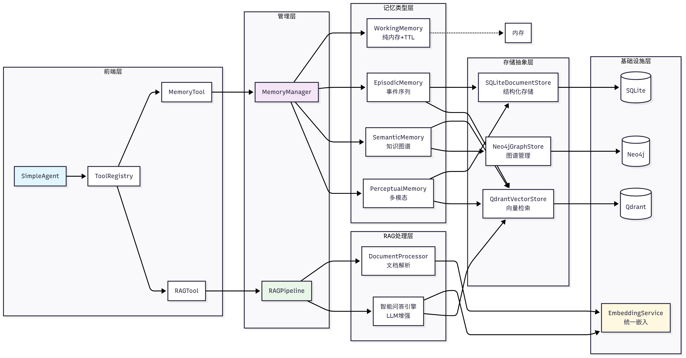
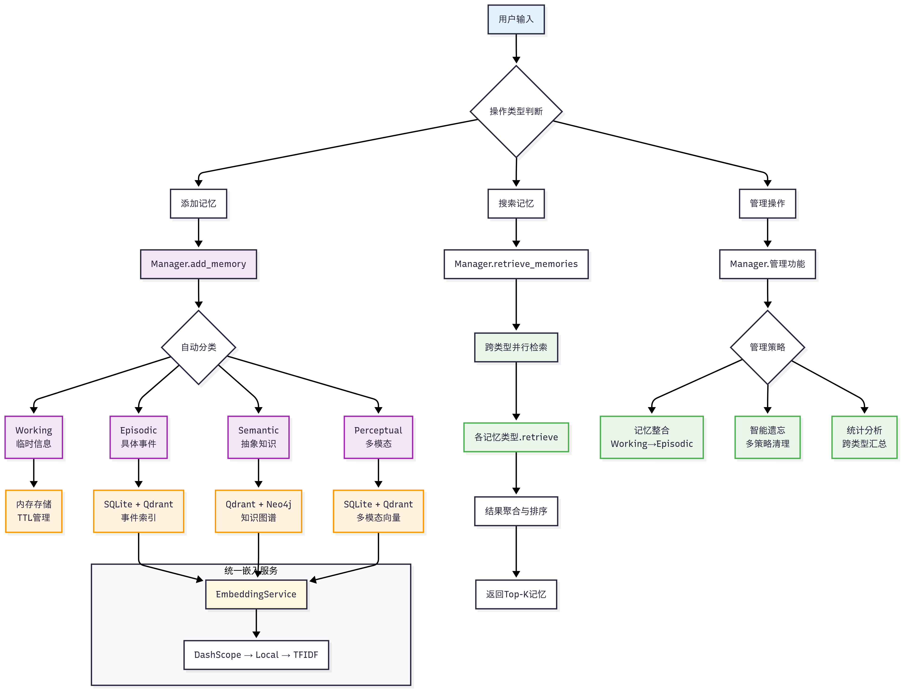

# ch8/ch9章节学习
## 任务
  > 阅读目标

- [第八章 记忆与检索](d:\za9za10\hello-agents\docs\chapter8\第八章 记忆与检索.md)——**精读**（RAG 是毕业作品基石 + 面试第一高频）
- [第九章 上下文工程](d:\za9za10\hello-agents\docs\chapter9\第九章 上下文工程.md)——**速读浏览即可**（细节留给八股周，按我们的重排）

  > 带着三个问题读 ch8

-  RAG 三个字母各代表哪个环节？
  检索增强生成
-  “检索”为什么需要向量化，而不是直接 `Ctrl+F` 关键词搜索？（这是 RAG 的核心思想）
    关键词搜索的方法计算词频和文档频率来评估相关性，对字面匹配效果好，但难以理解语义上的相似性。
    通过将文本转换为高维向量，模型能够理解和匹配语义上的相似性，而不仅仅是关键词。
-  记忆系统分哪几类？你昨天学的 `current_history`（工作记忆）和 `_history`（长期记忆）分别属于哪一类？
    工作记忆；情景记忆；语义记忆；感知记忆
    current_history显然属于工作记忆；_history则属于情景记忆

  > 打卡点（读完后答）

用一句话讲清 RAG 的完整流程——要求包含“检索→增强→生成”三环节，且能说出“增强”具体增强的是什么。（不许抄文档原话，用你自己的话）
将文本转换为高维向量，模型理解和匹配语义上的相似性，将匹配到的内容作为上下文添加到prompt，实现上下文增强，最后在增强后的上下文的基础上生成回答

> 一个重要的对照视角：你昨天刚刚在框架里见过记忆的“朴素形态”（两个 Python 列表）——读 ch8 时不断问自己：**向量数据库比列表强在哪？** 想通这一点，你就理解了“为什么毕业作品要用 RAG 而不是 `read_note` 工具”。
向量数据库比列表强在哪：为了方便模型查阅文件，列表需要手动添加每个文件主题，文件主题匹配不到的情况下仍然需要逐个文件进行关键词匹配，而向量数据库则可以直接通过向量理解和匹配语义上的相似性，提取相关文件内容
RAG 检索环节你漏了"离线"那一半——完整检索 = ①知识库文档提前切分+向量化入库（离线建索引，一次建好反复用）→ ②用户问题实时向量化 → ③相似度匹配取最相关的几块。你的描述从②③开始，补上①就完整了

- 补充：向量库的第二个优势：匹配粒度不同——你的 read_note 只能"整个文件"地读，菜单也只是文件名级；向量库是"内容块"级检索——问题"正则的 r 前缀"能直接命中笔记里讲 r 前缀的那几段，而不是甩给你整个文件。毕业作品要的就是这个粒度

今天读完文档 + 打卡回答，任务就完成。明天 10/10 是“给框架加记忆模块”的实战，后天 10/12 毕业作品 v1 起手——这两天读的东西会直接变成你手上的代码。**开始吧。**

## 相关概念
 1. 将记忆和RAG设计为两个独立的工具：
 - memory_tool负责存储和维护对话过程中的交互信息；
 - rag_tool则负责从用户提供的知识库中检索相关信息作为上下文，并可将重要的检索结果自动存储到记忆系统中。
 
 2. 记忆系统工作流程：
    
    记忆模块：
    - 工作记忆 (Working Memory)，它扮演着智能体“短期记忆”的角色，主要用于存储当前对话的上下文信息。
    - 情景记忆 (Episodic Memory)，它负责长期存储具体的交互事件和智能体的学习经历。
    - 语义记忆 (Semantic Memory)，它存储的是更为抽象的知识、概念和规则。例如，通过对话了解到的用户偏好、需要长期遵守的指令或领域知识点，都适合存放在这里。
    - 感知记忆 (Perceptual Memory)。该模块专门处理图像、音频等多模态信息，并支持跨模态检索。
 3. MemoryTool详解
    MemoryTool作为记忆系统的统一接口，其设计遵循了**"统一入口，分发处理"*的架构模式
    <detail>
    <summary>相关程序：<summarys>
   

    ```python
    def execute(self, action: str, **kwargs) -> str:
    """执行记忆操作

    支持的操作：
    - add: 添加记忆（支持4种类型: working/episodic/semantic/perceptual）
    - search: 搜索记忆
    - summary: 获取记忆摘要
    - stats: 获取统计信息
    - update: 更新记忆
    - remove: 删除记忆
    - forget: 遗忘记忆（多种策略）
    - consolidate: 整合记忆（短期→长期）
    - clear_all: 清空所有记忆
    """

    if action == "add":
        return self._add_memory(**kwargs)
    elif action == "search":
        return self._search_memory(**kwargs)
    elif action == "summary":
        return self._get_summary(**kwargs)
    # ... 其他操作
    ```
     <details>
    这种统一的execute接口设计简化了Agent的调用方式，通过action参数指定具体操作，使用**kwargs允许每个操作有不同的参数需求
    - 分流转交：execute 是前台，按 action 分流，把活转给对应的后台方法（_add_memory、_search_memory、_get_summary……）。和 MySimpleAgent 的 run() → _run_with_tools 是同一个模式，只是这里的分支更多（add/search/summary/stats/update……9 种操作）。
    - 下划线前缀 = 内部方法约定：_add_memory 的 _ 你见过——_auto_detect_provider 的规矩：对外只暴露 execute 一个入口，内部方法由 execute 自己调。外部用户只需会说"execute('add', ...)"，不需要知道背后有 9 个方法。
    - kwargs允许每个操作有不同的参数需求：9 种操作参数各不相同（add 要 content，search 要 query……），execute 用一个 **kwargs 全收，然后原封不动转给对应方法——这就是文档那句"kwargs 允许每个操作有不同的参数需求"的具体含义。你昨天的问题和今天读到的代码，在这里闭环了。
    def execute(self, action, **kwargs):        # ① 收集：所有操作的参数都收进 kwargs
    ...
    return self._add_memory(**kwargs)       # ② 拆开：原封不动透传给后台方法

    def _add_memory(self, content="", memory_type="working", ...):   # ③ 各取所需
4. 什么是RAG():检索增强生成（Retrieval-Augmented Generation，RAG）是一种结合了信息检索和文本生成的技术。它的核心思想是：在生成回答之前，先从外部知识库中检索相关信息，然后将检索到的信息作为上下文提供给大语言模型，从而生成更准确、更可靠的回答。
- 检索:从知识库中查询相关内容
- 增强：从知识库中查询相关内容
- 生成：生成则输出兼具准确性与透明度的答案。
