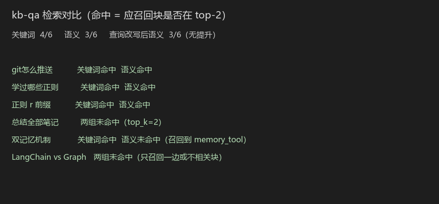

# 个人学习笔记问答系统（RAG 检索对比与评测）

用自己的 Markdown 学习笔记做问答：只根据检索到的片段回答；片段里没有就明确说「笔记中没有相关内容」。

面向个人笔记，不是通用搜索引擎。默认检索走本地向量，不把笔记发到付费 Embedding API。

**技术栈：** Python · RAG（切分 / 向量检索 / Prompt）· fastembed + `bge-small-zh-v1.5` · DeepSeek

---

## 怎么运行

在 `hello-agents` 仓库根目录（需已创建 venv，根目录 `.env` 里配置 DeepSeek，**不要把 Key 写进本文件**）：

```powershell
cd D:\za9za10\hello-agents
.\venv\Scripts\activate
python my-projects/kb-qa/kb_qa_v1.py
```

首次运行会下载 `BAAI/bge-small-zh-v1.5`（约 100MB）。笔记路径目前写死在代码里的 `NOTES_DIR`（`d:/za9za10/git`），换机器要改这一处。

主程序默认跑「双记忆」的改写+检索演示；对比实验时在 `__main__` 里改 `question` 即可。

运行截图（请把终端截图存为同目录 `screenshot.png`）：



---

## 架构

```
笔记 md（01–10 号，约 42 块）
    → 按换行后的 ## 切块
    → 本地 embedding（512 维）
    → 问题向量与每块算余弦相似度，取 top-2
    → 两块拼进 prompt，要求「没有就说没有」
    → DeepSeek 生成
```

另有一条**关键词基线**：用题目里的实词在块中出现次数排序，也取 top-2。只用于对比，不是默认问答路径。

可选：**查询改写**——检索前再调一次 LLM，把原问题收成短查询，再用短句做向量检索。生成仍用用户原话。

---

## 为什么用本地 Embedding

曾尝试 SiliconFlow 在线 embedding，接口变为收费后改成本地 `fastembed` + `bge-small-zh-v1.5`。

选型：零 Key、不限量、断网可建索引、笔记不出门。维度 512，够小项目用。

索引在启动时建一次（42 块向量），每次提问只向量化问题本身，避免每问都把全部笔记再 embed 一遍。

---

## 对比实验：关键词 vs 语义

**命中定义：** 事先指定的「应召回块」是否出现在该策略的 top-2 里。不看 LLM 答得好不好（答得好会把生成和检索搅在一起）。

6 题（不含「量子力学」「MCP」：库中无应召回块或未入库）。

| 策略 | 命中 |
|---|---|
| 关键词（实词出现次数） | **4/6** |
| 语义（余弦 top-2） | **3/6** |

| 题 | 关键词 | 语义 |
|---|---|---|
| git 怎么推送 | 命中 | 命中 |
| 学过哪些正则 | 命中 | 命中 |
| 正则 r 前缀 | 命中 | 命中 |
| 总结全部笔记 | 未命中 | 未命中 |
| 双记忆机制 | **命中** | 未命中 |
| LangChain vs LangGraph | 未命中 | 未命中 |

语义失败例：「双记忆机制」召回到 memory_tool / rag_tool，而答案在 08 笔记的「工作记忆 vs 长期记忆」。  
关键词失败例：「对比 LangChain 和 LangGraph」只召回了 LangChain 一边。

不是语义全面更好：题里已经有笔记用词时，关键词可能更准。

---

## 查询改写（做过，没有提升）

同一 6 题，检索改用 LLM 短查询后再做语义检索：**3/6 → 3/6**。

改写阶段看不到笔记库。模型不知道要把「双记忆」换成「工作记忆 / 长期记忆」，输出仍接近原句，检索块不变。`git → git push` 能改对，是因为提示词里有例子，不是因为读了笔记。

所以这里不写「优化了检索」，只写：试过查询改写，命中数没有提高。

---

## 失败案例（分层）

| 问题 | 层 | 原因 |
|---|---|---|
| 帮我总结所有笔记 | 召回 | `top_k=2`，不可能覆盖 42 块 |
| MCP 是什么 | 召回 | 11 号笔记在磁盘上，但 `NOTE_FILES` 只到 10 号 |
| 对比 LangChain / LangGraph | 召回 | 该进 top-2 的块没进；不是幻觉（模型没有编区别） |

当前没有切分/幻觉的硬案例。切分有一处隐患：` ## 续Day2` 前有空格，`split("\n##")` 没切开，r 前缀和「旅游助手」粘在同一块。

---

## 局限（面试可讲）

- 笔记白名单未包含 11 号及以后，MCP 等后续内容检索不到。
- 默认只取 2 块，不适合「总结全部」。
- 查询改写不读语料库，换不了笔记里的特殊用词。
- 尚未用 LangGraph 做状态机 / 最大步数 / 失败回灌（后续项目二）。
